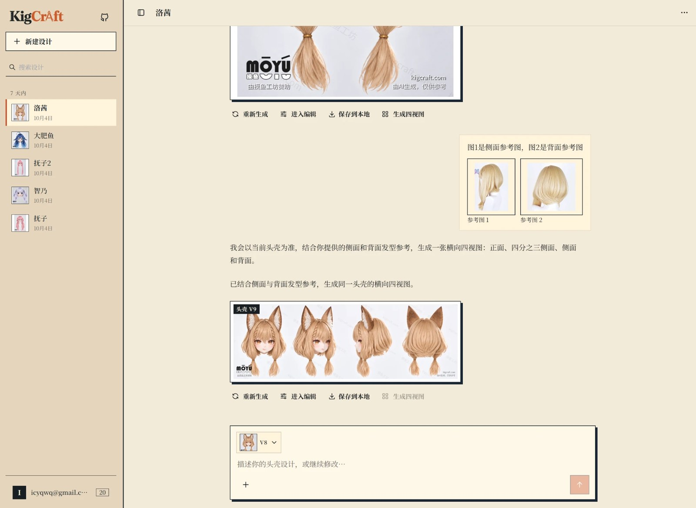

<p align="center">
  
</p>

<p align="center">
  <a href="README.zh-CN.md">中文</a> | English
</p>

<p align="center">
  <a href="LICENSE"></a>
  
</p>

KigCraft is a web tool for designing **Kigurumi (animegao) head shells**. Describe the character, drop in your
references, and it works the way a maker does: confirm the details that matter, draw a clean flat reference, render the
finished head shell, then lay out a four-view sheet. Everything can be refined afterwards in a built-in image editor.

> This is the **V2** branch: a conversation-driven design workspace with versioned images and an integrated editor.
> Image generation runs through the [Codex CLI](https://github.com/openai/codex) with your own ChatGPT login.



## What it does

**Design conversation**
- Start from references plus a short note, or ask for a head shell directly. A *flat reference first* mode (recommended)
  draws a clean, front-facing reference before the 3D head-shell render.
- Before generating, the input is reviewed. If something important is missing or ambiguous (hair, eyes, ears,
  accessories, conflicting references) you get a short question instead of a wasted generation.
- Every image is a numbered **version**. Edit any earlier message and resend to branch from that point; designs can be
  deleted and restored from the trash.
- Generate the **four-view sheet** from any approved front view, optionally with extra reference pictures per direction.

**Image editor**
- Face landmark detection that runs in the browser (MediaPipe plus an anime-face model), with manual correction.
- Face shape, eyes, mouth and brows with bounded, symmetric adjustments; free-form liquify; annotation layers.
- **Local regeneration**: paint a mask, describe the change, and the result replaces the current image in place. It
  stays undoable and does not create a new version.
- Closing the editor keeps its state; reopen the image to continue. Export a project bundle at any time.

**Service**
- Email-code sign-up and password login, terms acceptance, per-account daily generation quota, rate limits.
- Delivered images carry a tiled domain and "AI generated" watermark; your own revisions also show
  `v{number} · date` in the top-left corner.
- Admin pages: usage and Codex quota history, task audit, recovery of interrupted work, image anomaly alerts.
- Chinese, English and Japanese UI, picked from the browser.

## Architecture

| Part | Stack |
| --- | --- |
| `frontend/` | React, Vite, MUI, Konva canvas editor, i18next |
| `backend/` | FastAPI, SQLAlchemy 2 (async), Alembic, Pillow |
| Worker | `python -m app.operations.worker`: runs the Codex turns for queued operations |
| Storage | PostgreSQL (data), Redis, a filesystem volume for images (S3/MinIO optional) |

## Quick start (Docker)

Requirements: Docker with Compose, and a ChatGPT account that can use Codex image generation.

```bash
git clone -b v2 https://github.com/icyqwq/KigCraft.git
cd KigCraft
cp .env.example .env        # then set POSTGRES_PASSWORD and JWT_SECRET to long random values
```

Sign in to Codex once on any machine (`npm i -g @openai/codex && codex login`) and copy the resulting directory
(it contains `auth.json`) to `runtime/codex-home/`, or point `CODEX_CONFIG_DIR` in `.env` at it. The worker uses this
one login for every account. Never commit it.

```bash
docker compose up --build -d
```

Open <http://localhost:15173>. With `EMAIL_PROVIDER=console` the sign-up code is printed in the API log:

```bash
docker compose logs -f api | grep verification_code
```

After registering, make yourself an administrator:

```bash
docker compose exec api python -m app.auth.admin_cli promote --email you@example.com
```

The `migrate` service creates and upgrades the database schema on every start. Data lives in the `postgres-data`,
`assets` and `runtime` volumes.

### Style references (optional)

Generation can add two product-style photographs (a finished head shell and a four-view layout) as appearance guidance.
They are **not** shipped with this repository. To use your own, place `finished-head-shell.jpg` and
`four-view-layout.jpg` in `style-references/` next to `docker-compose.yml`. Without them everything works the same,
just without that guidance.

### Going public

Put a TLS reverse proxy in front of `frontend` (port 15173), then set `SESSION_COOKIE_SECURE=true`,
`APP_ENV=production`, real email delivery (`EMAIL_PROVIDER=tencent_ses` plus its keys) and, for open registration,
`CAPTCHA_ENABLED=true` with your own Cloudflare Turnstile keys. Keep `API_BIND_HOST` on loopback. Review the legal
texts in `frontend/src/i18n/resources/` and replace the operator contact with your own.

## Development

```bash
# backend (Python 3.12+); needs PostgreSQL and Redis, pointed to by DATABASE_URL / V2_DATABASE_URL / REDIS_URL
cd backend && pip install -e ".[dev]"
python -m app.db.migrate upgrade
uvicorn app.main:app --reload --port 18000
python -m app.operations.worker

# frontend (Node 22+)
cd frontend && npm ci && npm run dev      # proxies /api to http://127.0.0.1:18000
npm test                                  # design-token check, boundary check, vitest
```

Backend tests: `cd backend && pytest` (set `KIG_TEST_DATABASE_URL` to a throwaway PostgreSQL database).

## Credits and license

Developer: SeaRabbit / 海兔. User group: QQ 934715528.

KigCraft is released under **GPL-3.0-or-later**; see [LICENSE](LICENSE). Third-party notices for bundled libraries are
in `frontend/public/notices/`. The Codex CLI is a separate OpenAI product with its own terms; you are responsible for
how you use your account with it.
