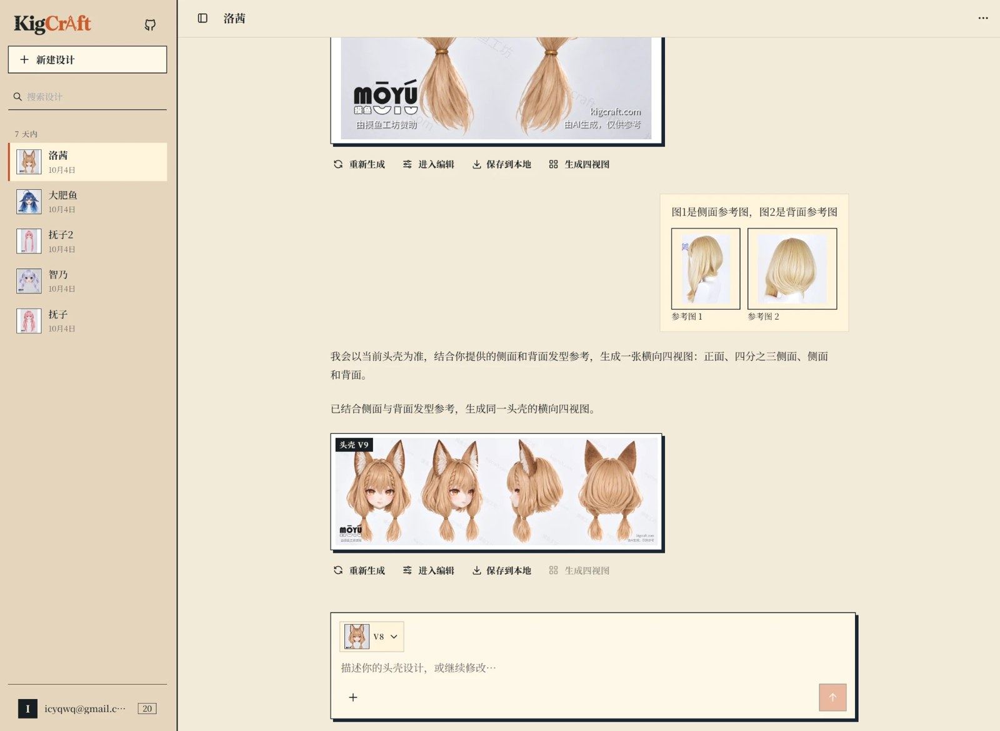

<p align="center">
  
</p>

<p align="center">
  中文 | <a href="README.md">English</a>
</p>

<p align="center">
  <a href="LICENSE"></a>
  
</p>

KigCraft 是一个用于设计**头壳（Kigurumi / 动漫头）**的网页工具。描述角色、上传参考图，它会按照制作者的习惯工作：先确认关键细节，
画出干净的平面参考图，再渲染头壳成品，最后排出四视图。之后还可以在内置图像编辑器里继续精修。

> 这是 **V2** 分支：以对话为核心的设计工作台，图片带版本号，并内置编辑器。
> 生图通过 [Codex CLI](https://github.com/openai/codex) 完成，使用你自己的 ChatGPT 登录。



## 功能

**设计对话**
- 上传参考图并写一句说明，或直接要头壳。推荐「先出平面参考图」模式：先画出正面、干净的平面参考，再做 3D 头壳渲染。
- 生成前会先审阅输入。头发、眼睛、耳朵、配饰缺失或参考图互相矛盾时，会先问你一个简短的问题，而不是浪费一次生成。
- 每张图都有编号**版本**。可以编辑任意历史消息并重新发送，从那一点分叉；设计可进回收站并恢复。
- 可从任意满意的正面图生成**四视图**，每个方向可额外附参考图。

**图像编辑器**
- 浏览器内识别面部关键点（MediaPipe 加动漫脸模型），可手动修正。
- 脸型、眼睛、嘴巴、眉毛的有限幅对称调整；自由液化；标注图层。
- **局部生成**：涂出蒙版、描述修改，结果就地替换当前图片，可撤销，也不会增加版本号。
- 关闭编辑器会保留状态，再次点击图片即可继续。随时可导出工程包。

**服务端**
- 邮箱验证码注册、密码登录、条款确认、按账号的每日生成额度和频率限制。
- 交付图片带平铺的域名和「AI 生成」水印；你自己的版本图左上角还有 `v版本号 · 日期`。
- 管理后台：用量与 Codex 额度曲线、任务审计、中断任务恢复、图片异常告警。
- 中文、英文、日文界面，按浏览器语言自动选择。

## 架构

| 部分 | 技术 |
| --- | --- |
| `frontend/` | React、Vite、MUI、Konva 画布编辑器、i18next |
| `backend/` | FastAPI、SQLAlchemy 2（异步）、Alembic、Pillow |
| Worker | `python -m app.operations.worker`：执行排队任务的 Codex 对话 |
| 存储 | PostgreSQL（数据）、Redis、图片文件卷（可选 S3/MinIO） |

## 快速开始（Docker）

需要：Docker（含 Compose），以及一个能使用 Codex 生图的 ChatGPT 账号。

```bash
git clone -b v2 https://github.com/icyqwq/KigCraft.git
cd KigCraft
cp .env.example .env        # 然后把 POSTGRES_PASSWORD 和 JWT_SECRET 改成足够长的随机值
```

在任意一台机器上登录一次 Codex（`npm i -g @openai/codex && codex login`），把生成的目录（含 `auth.json`）复制到
`runtime/codex-home/`，或在 `.env` 里用 `CODEX_CONFIG_DIR` 指向它。所有账号共用这一个登录。请勿提交到 Git。

```bash
docker compose up --build -d
```

打开 <http://localhost:15173>。`EMAIL_PROVIDER=console` 时，注册验证码会打印在 API 日志里：

```bash
docker compose logs -f api | grep verification_code
```

注册后把自己设为管理员：

```bash
docker compose exec api python -m app.auth.admin_cli promote --email you@example.com
```

`migrate` 服务每次启动都会创建/升级数据库结构。数据保存在 `postgres-data`、`assets`、`runtime` 三个卷。

### 风格参考图（可选）

生成时可以附加两张产品风格照片（头壳成品、四视图版式）作为外观指导。仓库**不包含**这些图片。想使用自己的，请把
`finished-head-shell.jpg` 和 `four-view-layout.jpg` 放进 `docker-compose.yml` 同级的 `style-references/` 目录。
没有它们一切照常，只是少了这项指导。

### 对外开放

在 `frontend`（15173 端口）前放一层 TLS 反向代理，并设置 `SESSION_COOKIE_SECURE=true`、`APP_ENV=production`、
真实邮件发送（`EMAIL_PROVIDER=tencent_ses` 及对应密钥）；开放注册时再启用 `CAPTCHA_ENABLED=true` 并填入你自己的
Cloudflare Turnstile 密钥。`API_BIND_HOST` 保持在回环地址。请检查 `frontend/src/i18n/resources/` 里的法律文本，
并把运营者联系方式换成你自己的。

## 开发

```bash
# 后端（Python 3.12+）；需要 PostgreSQL 和 Redis，用 DATABASE_URL / V2_DATABASE_URL / REDIS_URL 指向它们
cd backend && pip install -e ".[dev]"
python -m app.db.migrate upgrade
uvicorn app.main:app --reload --port 18000
python -m app.operations.worker

# 前端（Node 22+）
cd frontend && npm ci && npm run dev      # /api 代理到 http://127.0.0.1:18000
npm test                                  # 设计令牌检查、边界检查、vitest
```

后端测试：`cd backend && pytest`（用 `KIG_TEST_DATABASE_URL` 指向一个可随意清空的 PostgreSQL 库）。

## 致谢与许可

开发者：SeaRabbit / 海兔。用户群：QQ 934715528。

KigCraft 以 **GPL-3.0-or-later** 发布，详见 [LICENSE](LICENSE)。内置库的第三方声明在 `frontend/public/notices/`。
Codex CLI 是 OpenAI 的独立产品，有其自己的条款；如何使用你的账号由你自己负责。
